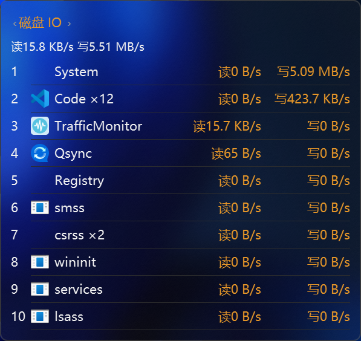
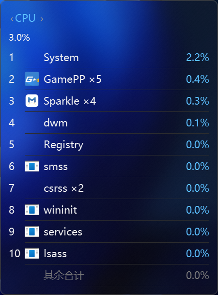
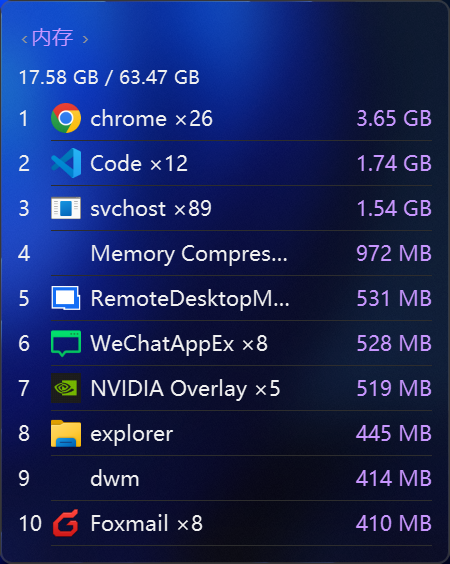
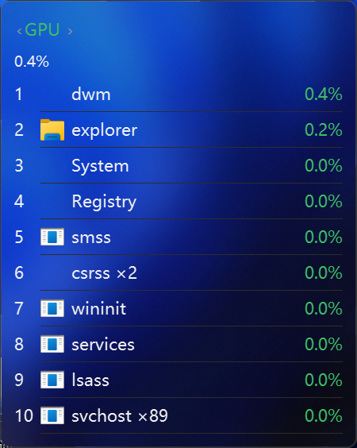
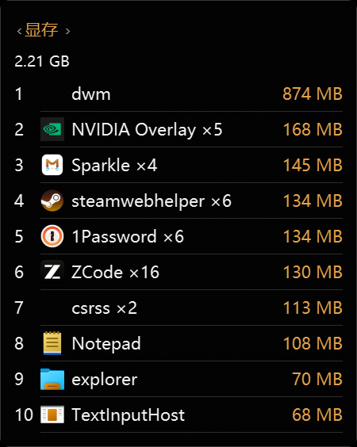

# ProcessTopMonitor - TrafficMonitor 插件

[TrafficMonitor](https://github.com/zhongyang219/TrafficMonitor) 的插件，显示每个进程的 CPU / 内存 / 磁盘 IO / GPU / 显存占用排行。与 [ProcessNetMonitor](https://github.com/deYangar/ProcessNetMonitor)（进程网速插件）同形式并存，悬浮窗自动互相避让。

## 效果预览











## 功能

- **五维进程排行**：CPU / 内存 / 磁盘 IO / GPU / 显存，每窗 Top 10（5 / 10 / 15 行可调）；每种指标一个主题色（CPU 橙 / 内存粉 / 磁盘 IO 蓝 / GPU 绿 / 显存黄）
- **磁盘 IO 按进程精确统计**：ETW FileIo 事件只统计真实文件读写，每行「读 / 写」双列，排序按 max(读, 写)（单边大户不被合计淹没）；窗口宽度随双列自适应
- **口径如实标注**：ETW 会话建不起来（非管理员等）时回退每进程 IO 总计口径（含网络 / 管道等非文件 IO），悬浮窗底部标注当前口径与中文原因（如「需管理员权限」），并提供重试指引——不存在「看着像精确值、实际是估算」的状态
- **GPU 与任务管理器同口径**：每进程取最忙引擎的 Utilization Percentage（3D / Copy / VideoDecode 等），引擎类型可多选 + 预设按钮；显存支持「专用」与「专用 + 共享」两种口径
- **内存两种口径**：专用提交（默认，更能反映进程真实负担）/ 工作集
- **出现方式**：默认悬停 TrafficMonitor 主窗或任务栏 400 ms 弹出、离开 300 ms 收起（hover）；插件「选项」可切「常驻显示」——可拖动、位置记忆；任务栏 item 点击 pin / unpin
- **单窗 + 切换 / 多窗并排**：单窗在头部点指标名或滚轮循环切换；多窗模式最多 6 窗并排，每窗固定一种指标，悬浮窗右键菜单添加 / 移除；拖过的窗口位置自动记忆
- **锚跟随**：hover 态跟随 TrafficMonitor 主窗 / 任务栏移动，亚克力背景层与内容逐帧同拍零分离；松手 / 移动中自动重新定位
- **与 ProcessNetMonitor 互相避让**：两插件悬浮窗并存时自动错位（PNM 占正位、PTM 让位到侧边），一方收起另一方自动归位
- **任务栏 item**：显示 CPU 第一名的进程名和占用（左名右值，长名省略号不裁切），点击弹出 / 收回悬浮窗组
- **头部传感器摘要**：可选叠加宿主 CPU / GPU 温度与 CPU 当前频率（PDH `% Processor Performance × MaxMhz`，0.1 GHz 精度，每秒更新）
- **四档视觉管线**：亚克力（默认）/ 透明 / 模糊 / 不透明，滑条调不透明度、拖动时实时反色保证可读；Win10 15063 起自动降级；深色 / 浅色主题跟随系统
- **高 DPI 支持**：150% / 175% / 200% 缩放适配（x86 宿主实测过）
- **切换不等待**：指标 / 口径 / 行数切换用最新快照同拍重灌，不闪旧值；IO / GPU 采集按需启停 + 迟停预热，切回 180 s 内的视图零冷启动，真停后切回走快路径（首拍即出值）
- **中英双语**：跟随 TrafficMonitor 主程序语言，也可在插件「选项」手动指定
- **崩溃诊断可关**：WER LocalDumps 默认开启，dump 落在插件 debug 目录；设置页「日志与诊断」板块可关（仅处理自有 DumpFolder，不碰其他插件的配置）

## 统计原理

### CPU / 内存 / IO 基础指标

每次刷新用 `NtQuerySystemInformation(SystemProcessInformation)` 单次快照取全进程的内核 + 用户 CPU 时间、工作集 / 专用提交页数、IO 读写字节累计，相邻两拍差分得到占用与速率。Idle 不进榜但参与系统占用汇总；System（PID 4）保留——它做真实工作（lazy writer 等）。

### 磁盘 IO：ETW FileIo 精确口径

- **主方案**（Win8+，需管理员权限）：自建系统日志会话 `PTMFileIoSession`（`EVENT_TRACE_FLAG_FILE_IO`，实时消费），与 ProcessNetMonitor 的 NT Kernel Logger 共存（多系统会话是 Win8+ 特性，互不抢占）
- TDH 解析 FileIo 事件按 PID 累计读 / 写字节，按刷新窗口差分出速率
- **累计式 handoff**：消费 tick 超时也不丢一窗数据（字节 + 窗口时长累计，下一拍合并消费）；不完整的窗口不接管，回退期间数据连续不闪 0
- **按需启停 + 迟停**：没有磁盘 IO 视图时 ETW 会话自动停止；180 s 迟停窗内切回零冷启动，超时真停后切回走快重试（250 ms × 4，残留会话自动接管，实测亚秒回精确口径）

### 回退口径

ETW 不可用时回退 `SystemProcessInformation` 的每进程 IO 计数器（全部句柄——文件 + 网络 + 管道等），按拍差分照常出排行；悬浮窗标注当前口径与原因。ETW 重试成功自动切回精确口径。

### GPU / 显存三级降级

- **G1**（Win10 1709+）：PDH `\GPU Engine(*)\Utilization Percentage` / `GPU Process Memory` / `GPU Adapter Memory`，引擎类型聚合
- **G2**（Win8 ~ Win10 1607）：`D3DKMTQueryStatistics`（gdi32 动态加载，微软 DDI 官方文档最低 Windows 8）；利用率 = NodeRunningTime 差分 ÷ (dt × 节点数)，显存仅专用口径；此档无引擎命名，引擎类型口径降级为全部节点求和，界面如实标注
- **G3**（Win7 / 无 GPU）：GPU / 显存排行维度隐藏（WDDM 1.1 无可靠的 per-process 路线，任务管理器也从未提供），头部摘要保留整机 GPU 利用率（取自 TrafficMonitor 宿主）

## 编译环境

- **编译器**：MSVC 14.44.35207 (Visual Studio 2022 BuildTools)
- **SDK**：Windows SDK 10.0.26100.0
- **C++ 标准**：C++17
- **依赖库**：gdi32.lib, user32.lib, shell32.lib, dwmapi.lib, advapi32.lib, tdh.lib, comctl32.lib, imm32.lib, msimg32.lib, pdh.lib
- **CRT**：静态链接（/MT），零第三方依赖；链接显式 `/OPT:REF`

## 编译部署

```bat
plugin\build_release.bat
```

一次编译 x64 与 x86 两个 DLL，产出在 `plugin\` 下（`ProcessTopMonitor.dll` / `ProcessTopMonitor_x86.dll`）。

**注意**：脚本头部硬编码了本机的 MSVC / SDK 路径（VS2022 BuildTools + Windows SDK 10.0.26100），换环境先改 `MSVC`、`SDK`、`SDKVER` 三个变量。

部署：关闭 TrafficMonitor（**TM 只能单实例**）→ 按宿主位数把 DLL 拷到 `<TM>\plugins\` → 启动 TrafficMonitor（管理员权限可解锁磁盘 IO 精确口径）。

## 文件结构

```
ProcessTopMonitor/
├── plugin/
│   ├── build_release.bat            # 一键编译（x64 + x86）
│   ├── src/
│   │   ├── PluginInterface.h        # TM 插件接口定义
│   │   ├── plugin_main.h / .cpp     # 插件主体（item / hover 状态机 / pin / 设置）
│   │   ├── window_manager.h / .cpp  # 窗组管理（组布局 / 显示 / 锚跟随 / PNM 避让）
│   │   ├── top_list_window.h / .cpp # 悬浮窗（ULW 视觉管线 / 菜单 / 交互）
│   │   ├── top_aggregator.h / .cpp  # 排行聚合（同名合并 / 排序 / TopN）
│   │   ├── metrics_collector.h / .cpp   # CPU / 内存 / IO 基础采集（SystemProcessInformation）
│   │   ├── etw_file_collector.h / .cpp  # ETW FileIo 精确磁盘 IO（A/B/C 三档）
│   │   ├── gpu_collector.h / .cpp   # GPU / 显存采集（G1 PDH / G2 D3DKMT）
│   │   ├── options_dialog.h / .cpp  # 设置对话框
│   │   ├── i18n.h / .cpp            # 本地化（跟随 TM 语言）
│   │   ├── lang/English.ini         # 英文语言文件（与 TM 语言文件同格式）
│   │   └── resource.rc / app.ico    # 资源与插件图标
│   ├── ProcessTopMonitor.dll        # 64 位编译输出
│   └── ProcessTopMonitor_x86.dll    # 32 位编译输出
├── docs/
│   ├── 技术方案.md                  # 技术方案（口径 / 降级链 / 视觉管线）
│   ├── plans/                       # 各里程碑落地方案与验收记录
│   └── screenshots/                 # README 界面图
└── README.md
```

## 多语言（Localization）

插件 UI 默认中文，跟随 TrafficMonitor 主程序语言自动切换：

- 语言文件位于 `plugins/ProcessTopMonitor/lang/`（插件配置目录内），格式与 TM 的 `language/*.ini` 完全一致（UTF-8 BOM，`[text]` section，`KEY = "value"`）
- 中文为内置兜底：未找到语言文件或 key 未翻译时自动显示中文原文
- 内置 **English**；界面语言也可在插件「选项」手动选择（重启后保持）

### 贡献翻译

无需编译，只需提交一个 ini 文件：

1. 复制 `plugin/src/lang/English.ini` 为 `plugin/src/lang/<语言名>.ini`
2. 修改 `[general]` 的 `BCP_47`（如 `id-ID`）与 `DISPLAY_NAME`
3. 把 `[text]` 中每个 `"英文"` 翻译成你的语言（**key 保持中文原文不变**）
4. 安装时把 ini 放入 `plugins/ProcessTopMonitor/lang/`

## TM 配置

1. TrafficMonitor → 右键 → 插件管理 → 勾选启用 ProcessTopMonitor
2. 在任务栏设置中把 ProcessTopMonitor 的 item 添加到任务栏（CPU Top1 进程 + 点击弹出悬浮窗组）
3. 插件管理 → ProcessTopMonitor → 「选项」调整：出现方式（悬停 / 常驻）、默认指标、多窗口并排、刷新率（250 / 500 / 1000 / 2000 ms）、内存口径、显存口径、IO 视图、GPU 引擎、效果与透明度、传感器摘要等

## 数据存储

- **设置**：`settings.json`，位于 TM 插件配置目录下的 `ProcessTopMonitor\`（非 portable 模式在 `%APPDATA%\TrafficMonitor\plugins\`，portable 模式在 `<exe_dir>\plugins\`；跟随 TrafficMonitor 的模式）
- 格式版本 schema 3，自动兼容 / 迁移 v1 / v2 旧配置
- **调试与崩溃**：同目录 `debug\`（目录树见下节）

## 调试日志与崩溃排查

- **开关**：插件「选项」→「日志与诊断」板块（调试日志 + 崩溃转储开关 + 「打开目录」按钮）
- **位置**：全部输出与配置同处一处：
  ```
  plugins/
  ├── ProcessTopMonitor.dll
  └── ProcessTopMonitor/
      ├── settings.json            ← 配置
      ├── lang/                    ← 语言文件（如 English.ini）
      └── debug/
          ├── werdumps/            ← WER 转储目录（崩溃转储开启时自动注册）
          ├── etw_file.log         ← ETW 磁盘 IO 采集诊断（调试日志开启后生成）
          ├── crash.log            ← 崩溃日志（仅崩溃时生成）
          └── crash.dmp            ← 崩溃转储（仅崩溃时生成）
  ```
- **崩溃日志不受开关控制**：crash.log / crash.dmp / werdumps 仅在崩溃时写入，平时不产生文件，保持始终启用以便排查闪退
- **遇到闪退时**：把 `debug/` 目录（含 crash.log、werdumps 下的 .dmp）连同 DLL 版本一起反馈即可定位

## 开发文档

- 技术方案：[docs/技术方案.md](docs/技术方案.md)
- 里程碑方案与验收记录：[docs/plans/](docs/plans/)
- 开发进度：[PROGRESS.md](PROGRESS.md)
