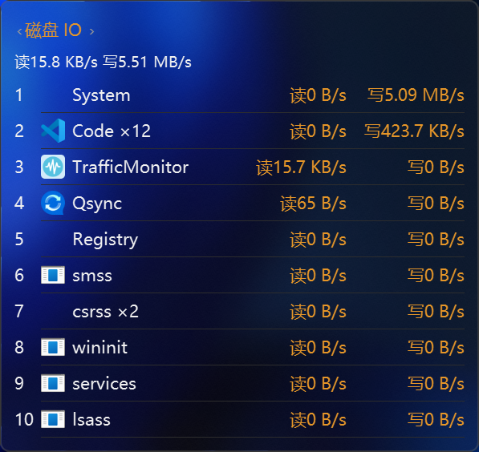
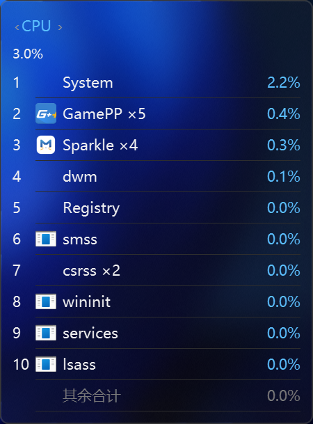
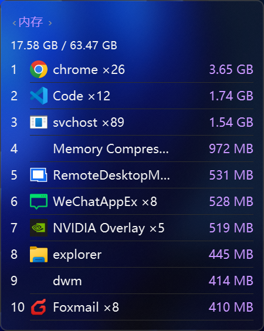
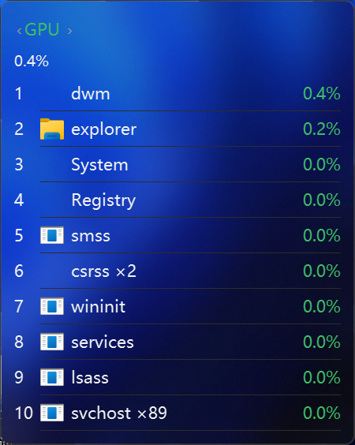
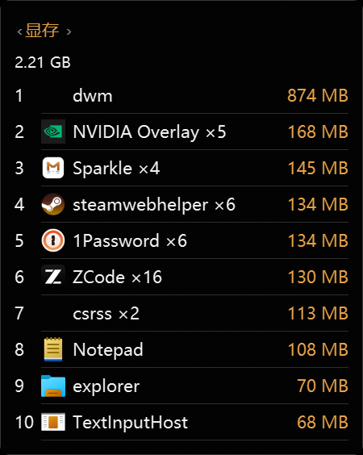

# ProcessTopMonitor v1.0.0 — 首个公开版本：五维进程排行悬浮窗（CPU / 内存 / 磁盘 IO / GPU / 显存）

| 磁盘 IO 视图 | CPU 视图（核型分列） | 内存视图 |
|:---:|:---:|:---:|
|  |  |  |

| GPU 视图 | 显存视图 |
|:---:|:---:|
|  |  |

[TrafficMonitor](https://github.com/zhongyang219/TrafficMonitor) 的插件，悬浮窗显示每个进程的资源占用排行，与任务管理器同源口径；与 [ProcessNetMonitor](https://github.com/deYangar/ProcessNetMonitor)（进程网速插件）同形式并存，悬浮窗自动互相避让。

## 功能

- **五维进程排行**：CPU / 内存 / 磁盘 IO / GPU / 显存，每窗 Top 10（行数可调），头部可选叠加宿主温度与 CPU 频率；五种指标最多 6 窗并排，每窗固定一种指标（右键增删）
- **磁盘 IO 按进程精确统计**：自建 ETW FileIo 会话只算真实文件读写，「读 / 写」双列与任务管理器资源监视器同源；采集内核会话按需启停（180 秒迟停窗内切回零冷启动）；累计式 handoff 保证消费超时不丢窗口数据
- **混架 CPU 核型分列**：Intel 大小核显示「P核 / E核」双列，AMD X3D 双 CCD 显示「X3D / 标准」双列——检测到混架自动启用，同构机器自动回落纯总量（界面零变化）；计量走内核调度事件的时间账，与任务管理器同口径；CPU 行悬停显示 P/E 明细，托盘提示含系统级汇总
- **GPU 与任务管理器同口径**：每进程取最忙引擎；显存支持「专用」与「专用 + 共享」两种口径；GPU 引擎类型可在设置中筛选
- **出现方式随人**：默认悬停 TrafficMonitor 主窗或任务栏 400 ms 弹出、离开 300 ms 收起；可常驻显示（拖动记忆位置）或多窗并排；hover 态跟随 TM 主窗移动
- **常驻窗置顶 / 穿透 / 自定义大小**：可关「窗口置顶」让悬浮窗落到桌面部件层（壁纸之上、普通窗口之下，Win+D 仍可见）；「鼠标穿透」开启后不接收任何输入，成为纯显示 HUD（取消入口在设置面板）；常驻 / 固定态可拖边缘自由调整大小（拉高显示更多行，上限 15 行，右键「恢复默认大小」一键还原）；数据刷新不扰动窗口层级，与其他软件的置顶菜单 / 悬浮窗互不遮挡
- **任务栏 item**：显示 CPU 第一名的进程名和占用，点击弹出 / 收回悬浮窗组
- **四档视觉效果**：亚克力 / 透明 / 模糊 / 不透明，透明度可调；深浅色跟随系统；高 DPI 适配
- **中英双语**：跟随 TrafficMonitor 语言或手动指定，中文内置兜底
- **健壮性**：崩溃自动留档（crash.log / crash.dmp，插件目录 debug\ 下，用于问题定位）；设置 schema 自动迁移旧版本

## 版本说明（3 个产物）

| 文件 | 说明 |
|---|---|
| `ProcessTopMonitor.dll` | x64（64 位 TrafficMonitor 使用） |
| `ProcessTopMonitor_x86.dll` | x86（32 位 TrafficMonitor 使用） |
| `ProcessTopMonitor-lang-v1.0.0.zip` | 完整安装包（x64 + x86 DLL + 语言文件，非中文用户下载，解压到 plugins 目录即可用） Complete bundle (x64 + x86 DLLs + language files, for non-Chinese users; extract into the plugins/ folder, ready to use) |

选择与你的 TrafficMonitor 主程序位数一致的 DLL，放入 TM 的 `plugins/` 目录。

## 安装前提

1. Windows 8 及以上（Windows 7 下 CPU / 内存 / IO 可用，GPU / 显存维度因系统限制自动隐藏）；x64 与 x86 宿主均支持
2. TrafficMonitor 主程序（插件版）
3. **建议以管理员权限运行 TrafficMonitor**：解锁磁盘 IO 精确口径与混架 CPU 核型明细；普通权限自动回退并在界面如实标注原因，权限恢复后自动切回（无需重启）

## 已知说明

- 无管理员权限时：磁盘 IO 回退「每进程 IO 总计」口径（含网络 / 管道等全部句柄，数值偏大），悬浮窗标注当前口径与原因；核型明细回落纯总量。ETW 重试成功后自动切回精确口径（亚秒级）
- Windows 8 ~ Windows 10 1607：GPU 走 D3DKMT 口径（利用率按全部节点求和、显存仅专用口径），界面如实标注；Windows 7 无可靠 per-process GPU 路线，GPU / 显存维度隐藏（任务管理器在这些系统上也从未提供过）
- System（PID 4）保留在榜内：它承担真实内核写入工作（lazy writer 等）；混架机器可在设置中关闭其核型归因
- 「其余合计」行为与榜单同口径，使上方汇总与下方加总账面闭合；核型分列视图的百分比与摘要行分母口径不同（群内归一 vs 全核归一），对账关系详见 README
- TrafficMonitor 仅支持单实例；切换 DLL 前请先完全退出 TM 再覆盖文件
